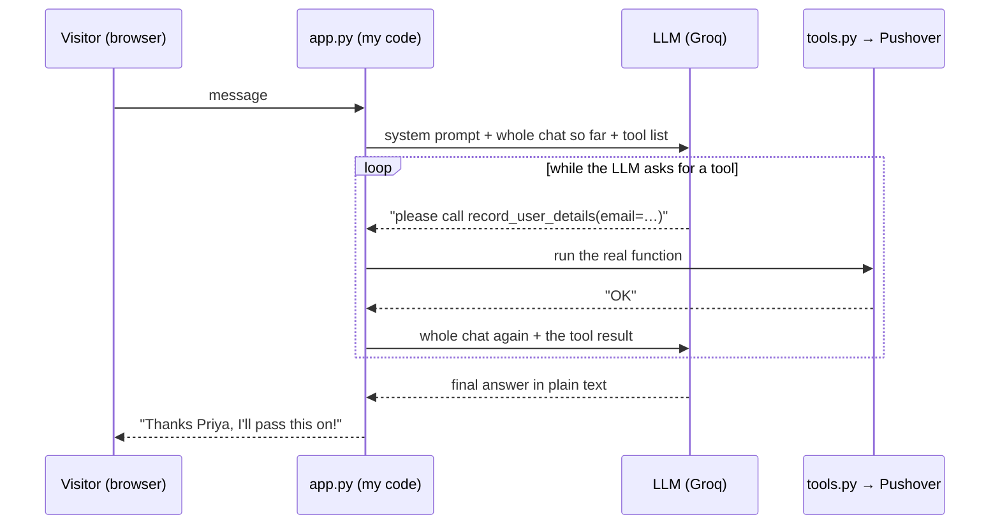

# AI Digital Twin

**Live:** https://ai-digital-twin-l13v.onrender.com/
(free tier: if nobody has visited for 15 minutes, the first load takes 30–60 seconds to wake up)

A chatbot that answers questions about my career, as me. A recruiter can ask "what do
you work on?" and get an answer from my profile. If they leave their email, or ask
something the twin can't answer, my phone gets a push notification.

Built in Week 1 of Ed Donner's *AI Engineer Agentic Track* course, starting from the
[ed-donner/agents](https://github.com/ed-donner/agents) repo (MIT license).

**Stack:** Python · Gradio (UI + server) · Groq `openai/gpt-oss-120b` (through the OpenAI
client) · Pushover (phone notifications) · Render (hosting)

---

## How it works

Example: a visitor types *"I'd like to hire you, my email is priya@example.com"*.



1. `context.py` builds the **system prompt**: who I am (`summary.txt`), my LinkedIn
   profile (`linkedin.txt`) and the rules (stay on career topics, never make things up,
   use a tool when you don't know).
2. `app.py` sends that prompt, the **whole conversation so far** and the **list of
   tools** to the LLM.
3. If the LLM replies "call a tool", my code runs it, adds the result to the
   conversation and asks again. This repeats until the LLM answers in plain text.
4. `tools.py` has two tools, both send a Pushover notification:
   - `record_user_details`: a visitor left their email
   - `record_unknown_question`: the twin didn't know an answer
5. Gradio draws the chat page and runs the web server.

### Files

| File | What it does |
|---|---|
| `app.py` | LLM client, the tool-calling loop, Gradio page, server start |
| `context.py` | Builds the system prompt from `summary.txt` + `linkedin.txt` |
| `tools.py` | The two tools, their JSON schemas, and the dispatcher |
| `styles.py` | Gradio theme, header HTML, small layout CSS |
| `summary.txt` | A few lines about me, in my own words |
| `linkedin.txt` | LinkedIn "Save to PDF" export as text, phone and email removed |

---

## What I learned

### 1. The LLM has no memory
Every API call is a fresh start. The app fakes memory by **re-sending the whole chat
every time**: `messages = system + history + [new message]`. So long chats cost more
(old messages get paid for again each turn), and anything the app drops is truly
forgotten.

### 2. The LLM never runs tools. My code does.
The model only writes text. "Calling a tool" means it replies with a structured
request (`record_user_details` with `{email: ...}`). My code spots that, runs the real
function and sends the result back. The LLM and Pushover never talk to each other.

### 3. That loop *is* the agent
- **`while`**: after a tool result, the model may ask for *another* tool. Keep looping
  until it answers in plain text. **The LLM decides when it's done.**
- **`for`**: one reply can ask for several tools at once. Answer every one, or the next
  API call is rejected.
- Agent frameworks (OpenAI Agents SDK, CrewAI, LangGraph) wrap this same loop. This
  project does it by hand.

### 4. Context engineering: the model only knows what's in the request
The system prompt + history + tools = the "context" for one call. Two lessons:
- **Anything in the context can come back out in an answer.** My LinkedIn export
  included my phone number, so the twin could have told it to anyone who asked. I
  stripped contact details before they go in.
- Small docs can just be pasted in whole. That's the simplest form of RAG; real RAG
  (search, then paste the best chunks) is for when the docs don't fit.

### 5. "OpenAI-compatible" doesn't mean identical
Groq accepts the OpenAI client with a different `base_url` and key, but it's
**stricter**. Gradio's history has extra fields (`metadata`, `options`). OpenAI ignores
them; Groq rejects the request. Fix: send only `role` + `content`.

### 6. Where an LLM app can be hosted depends on the *app*, not the AI
- The LLM runs on Groq's servers. My app is a small backend that holds the API key and
  runs the loop.
- **Gradio is a long-running server.** It stays up and keeps a live connection
  (Server-Sent Events) open to the browser for the chat. That needs a host that keeps a
  process running: Render, Fly, Railway, Hugging Face Spaces.
- **Vercel / Netlify** run code per request and shut it down after a few seconds, so
  Gradio doesn't fit. A Next.js version (chat page + `/api/chat` route running the same
  loop) would deploy there fine.
- **A plain static React app can't do this safely:** the API key would ship in the
  browser bundle for anyone to copy. Some server-side code must hold it.
- Hugging Face Spaces made Gradio hosting paid in July 2026, which is why this is on
  Render's free tier.

### 7. `127.0.0.1` vs `0.0.0.0`
The first Render deploy timed out with "no open ports detected". Gradio listens on
`127.0.0.1` (only reachable from inside the machine) by default. Render's router comes
from outside, so the app must listen on `0.0.0.0` and the port Render gives in `$PORT`.
The code now does that whenever `PORT` is set; local runs are unchanged.

### 8. Secrets
Keys live in `.env` locally (git-ignored) and in Render's Environment settings in
production. `.env.example` lists the names without values. Never commit keys.

### 9. Styling Gradio: theme first, CSS last
The course's CSS was ~300 lines of `!important` overrides fighting Gradio's internal
class names, which broke in small ways. A `gr.themes.Base(...).set(...)` theme (colors,
font, corners, light/dark) plus a short layout stylesheet was simpler and more stable.

---

## Bugs I hit

- **Second message crashed the page.**
  Cause: Gradio history fields that Groq rejects. Fix: keep only `role` + `content`.
- **Render deploy timed out.**
  Cause: app bound to `127.0.0.1`. Fix: bind `0.0.0.0:$PORT` when `PORT` is set.
- **Twin claimed my agent projects were "all TypeScript".**
  Cause: the model filled a gap in its context with a guess. Fix idea: say more in
  `summary.txt` (the course is in Python).
- **Replies used wide tables that wrapped badly in the chat.**
  Fix: prompt asks for short bullets and no tables.
- **(Course version) saving three emails at once crashed the page.**
  Cause: only the first of three tool calls was answered. Fix: the `for` loop over all
  tool calls in `handle_tool_calls`.

---

## Run locally

```bash
cp .env.example .env    # then fill in the three values
uv run --with-requirements requirements.txt app.py
```

Open http://127.0.0.1:7860. Without `uv`: `pip install -r requirements.txt` then
`python app.py`.

### Environment variables

| Name | Where to get it |
|---|---|
| `GROQ_API_KEY` | console.groq.com → API Keys |
| `PUSHOVER_USER` | pushover.net home screen (starts with `u`) |
| `PUSHOVER_TOKEN` | your Pushover application's token (starts with `a`) |

## Deploy on Render

1. New → **Web Service** → pick this repo.
2. Language **Python 3**, build `pip install -r requirements.txt`, start `python app.py`,
   instance type **Free**.
3. Add the three environment variables above.
4. Every `git push` to `main` redeploys automatically.

Before sharing the link, set a monthly spend limit with the LLM provider: every visitor's
chat uses your credits.

---

## Ideas for next time

- **Cap the loop**: stop after ~5 tool rounds so a confused model can't loop forever and
  burn credits.
- **Stream replies** token by token instead of waiting for the full answer.
- **Real RAG**: a small knowledge base about me (projects, write-ups), searched per
  question instead of pasting everything.
- **Evaluator**: a second LLM call that checks each answer against the profile before
  it's shown (Day 4 pattern).
- **More tools**: e.g. a small FAQ store the twin can read and write.
- **Next.js rewrite** on Vercel, to see the same loop in TypeScript.
